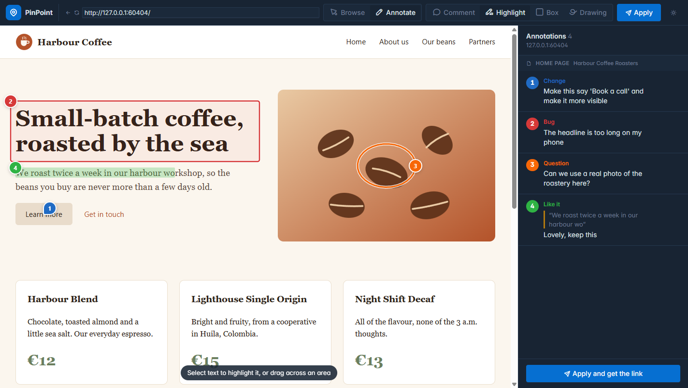
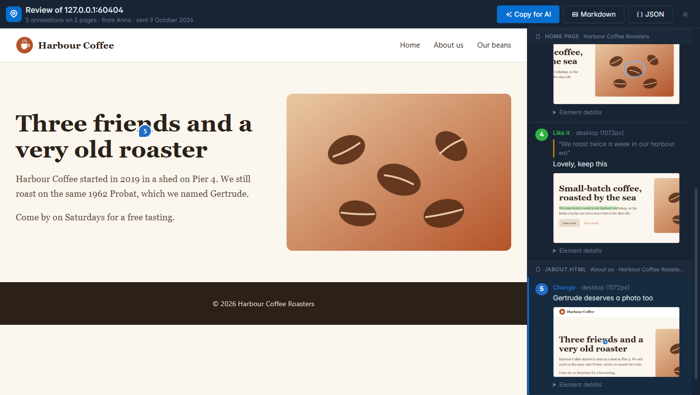

# PinPoint

[](https://github.com/ReDCLiF-Unknow/pinpoint/actions/workflows/ci.yml)
[](LICENSE)

Website feedback a coding AI can act on. A customer types the address of their website, marks up the live
page with comments, highlights, boxes and drawings, and presses **Apply**. They get a link to send to whoever
builds the site, who pastes it into their coding AI. The AI reads every mark as a numbered task, each with the
page, the screen width, the element's CSS selector, its text and HTML, the customer's comment, and a
screenshot with the mark drawn on it.

Go, SQLite, `html/template` and the [Tabler](https://tabler.io) UI. One binary serves everything, including
its own CSS, scripts and fonts.



## How it works

1. **Enter a URL.** The customer opens PinPoint, or a link the agency sent with the address filled in
   (`https://your-pinpoint/?url=https://client.example`). There is no account to make.
2. **Review.** The site opens inside PinPoint with a toolbar on top. In **Browse** mode it works as usual:
   links, menus, scrolling. In **Annotate** mode clicks mark the page:

   | Tool      | What it does                                                  |
   |-----------|---------------------------------------------------------------|
   | Comment   | Click an element and say what you want                         |
   | Highlight | Select text, or drag across an area                           |
   | Box       | Drag a box, or click an element to frame it                   |
   | Drawing   | Circle or sketch anything                                     |

   Each mark gets a label (**Change**, **Bug**, **Question** or **Like it**) and a comment.
3. **Apply.** One click gives the review its link. The customer keeps their edit link (the page they are on),
   and can carry on changing the review: the link always shows the latest.
4. **Hand it to the AI.** The same link serves two audiences. A browser gets the site with every mark on it
   and the list beside it. A coding AI, `curl` or anything else that doesn't ask for HTML gets the review as
   Markdown. There is also **Copy for AI**, and `.md` and `.json` versions of every review.



Here is what the AI reads (shortened):

~~~markdown
# Review of harbour-coffee.example (5 annotations)

Feedback from Anna, sent 9 October 2026. Review: https://pinpoint.example/r/Fss21wmov4hq_Om6

They marked these up on the live website. Each numbered item is one task. ...

## 1. Change: Home page, desktop (1072px)
- Page: https://harbour-coffee.example/
- Element: `a.btn.btn-primary` (link, text "Learn more")
- Comment: "Make this say 'Book a call' and make it more visible"
- Marked with: a pin, 50% across and 50% down the element
- Screenshot: https://pinpoint.example/r/Fss21wmov4hq_Om6/1.png
- HTML:

  ```html
  <a class="btn btn-primary" href="/about.html">Learn more</a>
  ```
~~~

Marks are attached to the element they are about, not to a spot on the screen, so they follow the layout
when the window is a different size. If the element has moved or gone when the review is opened again
(after the agency's changes, say), the mark stays where it was drawn and is flagged as moved.

## How the site is shown

Most websites refuse to be shown in a frame on another site, so PinPoint fetches each page itself and serves
it from its own address, with the review script added. Only the page comes through PinPoint: everything it
loads (styles, scripts, images) comes straight from the real site, as it would without PinPoint.

- **The page can't touch PinPoint.** It runs in a sandbox with an origin of its own, so its scripts cannot
  read PinPoint's pages, cookies or storage.
- **Nothing is sent to the site.** Forms are not submitted while reviewing, and nothing is signed in: PinPoint
  never passes on cookies.
- **Screenshots fetch only what they need.** A screenshot needs the page's images and fonts, so PinPoint
  fetches those for it. From the site being reviewed it passes on anything, but from other sites only images,
  fonts and stylesheets, so nobody can use a review to read other websites through PinPoint.
- **Only public websites.** PinPoint will not fetch addresses on private networks or on the machine it runs
  on, so nobody can use it to look inside the network it runs in. For a server only you can reach, set
  `PINPOINT_ALLOW_PRIVATE=on` to review sites on your own machine or network.

Some sites don't work fully through the proxy, in particular single-page apps that route in the browser and
sites behind a login. A script snippet the agency adds to the site itself is planned for those.

## Install

**Docker**:

```
docker run -d --name pinpoint -p 8080:8080 -v pinpoint:/data ghcr.io/redclif-unknow/pinpoint:main
```

Or with the [compose file](compose.yaml): `docker compose up -d`. Reviews live in one SQLite file in the
`/data` volume, so keep that volume: a container without it starts empty, and every review link made before
then leads nowhere.

**From source**, with Go 1.26:

```
go run ./cmd/server -addr localhost:8080
```

Then open <http://localhost:8080>. Put it behind HTTPS (Caddy, nginx, a hosting platform) to use it on the
internet. PinPoint reads `X-Forwarded-Proto` to build its links.

## Development

```
go test ./...
python tools/vendor/fetch.py     # refresh vendored CSS, fonts, icons and the screenshot library
python tools/icons/make.py       # redraw the app icons
```

`tools/demo-site` is a small made-up coffee shop site to review while developing. Serve it with
`python -m http.server 8096 --directory tools/demo-site` and run PinPoint with `PINPOINT_ALLOW_PRIVATE=on`.

## Licence

MIT. Vendored: Tabler and Tabler Icons (MIT), Inter (SIL Open Font License), modern-screenshot (MIT).
